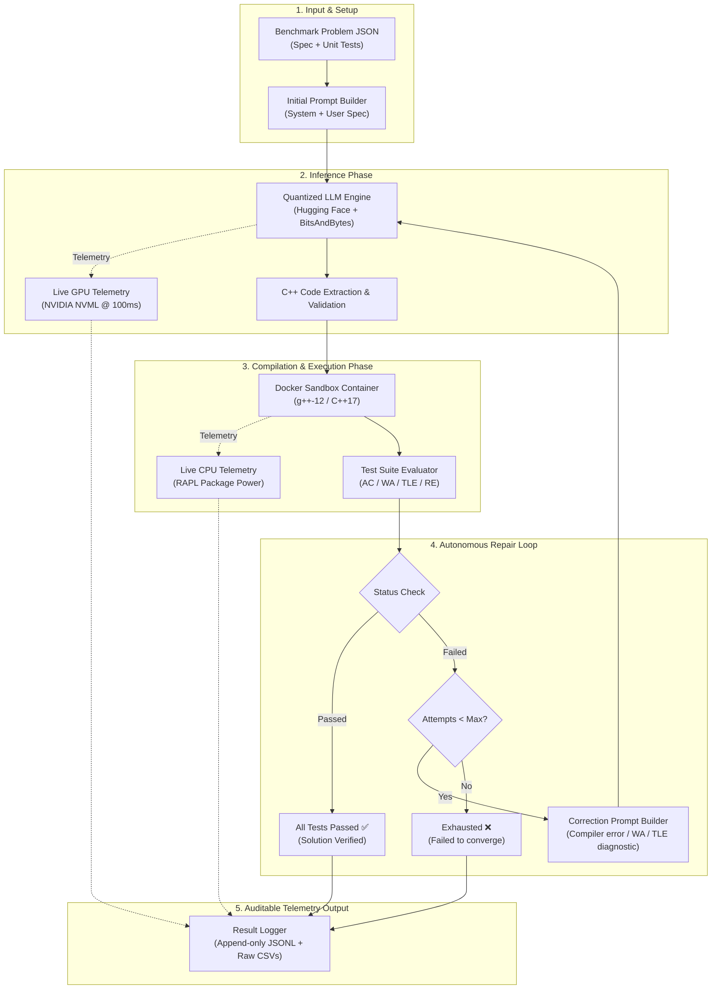

# RepairTax-LLM ⚡

[](https://www.python.org/)
[](https://pytorch.org/)
[](https://www.docker.com/)
[](https://isocpp.org/)
[](https://developer.nvidia.com/management-library-nvml)
[](https://github.com/LibreHardwareMonitor/LibreHardwareMonitor)

> **RepairTax-LLM** is an experimental benchmarking pipeline designed to measure the **true energy, carbon, and computational cost** ("repair tax") of iterative LLM-based C++ code generation, compilation, execution, and multi-round automated program repair.

---

## 📌 Overview

Iterative code generation pipelines repeatedly prompt Large Language Models to diagnose and fix compilation errors, runtime exceptions, and failing unit tests. While functional accuracy increases across iterative repair rounds, the cumulative energy consumption (inference, compilation, execution) and associated carbon footprint can escalate dramatically.

**RepairTax-LLM** provides an end-to-end framework featuring:
- **Phase-Separated Energy Measurement**: Isolate idle baseline, LLM inference, C++ compilation, and sandboxed test execution energy.
- **Hardware-Level Telemetry**: Direct GPU sampling via **NVIDIA NVML** and CPU package measurement via **Intel RAPL** (using LibreHardwareMonitor).
- **Secure Sandboxed Execution**: Automatic warm-container Docker isolation with strict execution timeouts and memory quotas.
- **Multi-Round Autonomous Repair**: Closed-loop prompt building, syntax extraction, failure attribution, and targeted feedback injection.
- **Auditable Carbon Attribution**: Computes embodied and operational carbon emissions using regional electrical grid carbon intensities ($g\text{CO}_2/\text{kWh}$).

---

## 🏗️ System Architecture



---

## 📂 Directory Layout

```text
RepairTax_LLM/
├── docker/
│   └── Dockerfile                  # Sandboxed C++17 execution container
├── data/
│   └── problems/                   # Curated benchmark problems (30 HackerRank tasks)
│       ├── HR_E_001.json ...       # Easy difficulty tier (10 problems)
│       ├── HR_M_001.json ...       # Medium difficulty tier (10 problems)
│       └── HR_H_001.json ...       # Hard difficulty tier (10 problems)
├── prompts/                        # LLM prompt templates
│   ├── initial_system.txt          # System context for initial solution drafting
│   ├── initial_user.txt            # User problem description formatting
│   ├── correction_system.txt       # System prompt for iterative repair rounds
│   ├── compile_correction_user.txt # Diagnostics prompt for compiler failure
│   ├── timeout_or_runtime_user.txt # Diagnostics prompt for TLE or runtime crashes
│   └── wrong_answer_user.txt       # Diagnostics prompt for failing test assertions
├── src/                            # Telemetry & execution pipeline source
│   ├── main.py                     # Primary CLI entry point
│   ├── orchestrator.py             # Multi-round repair orchestrator loop
│   ├── llm_client.py               # Hugging Face inference with 4-bit/8-bit quantization
│   ├── docker_sandbox.py           # Docker container management & isolation
│   ├── compiler.py                 # Sandboxed g++ compiler runner
│   ├── test_runner.py              # Test harness & output comparator
│   ├── energy_monitor_gpu.py       # NVML GPU energy counter & sampling
│   ├── energy_monitor_cpu.py       # RAPL CPU package power monitor
│   ├── carbon_tracker.py           # Grid-intensity carbon accounting
│   ├── result_logger.py            # Append-only result & telemetry persistence
│   ├── prompt_builder.py           # Dynamic prompt generation
│   ├── code_extraction.py          # Markdown C++ extraction regex
│   ├── schema.py                   # Data schemas for attempts and problems
│   ├── config_loader.py            # YAML validation & configuration loader
│   └── run_single_problem.py       # Single-problem debugging script
├── config.yaml                     # Experiment & hardware configuration
├── requirements.txt                # Python package dependencies
├── smoke_test.py                   # Sanity check for GPU, CPU, and inference
└── README.md                       # Project documentation
```

---

## ⚡ Prerequisites & Setup

### 1. Prerequisites
- **OS**: Windows 11 (tested natively on Lenovo LOQ 15IRX10) or Linux
- **GPU**: NVIDIA GPU with CUDA support (e.g., RTX 40/50 series)
- **Docker**: [Docker Desktop](https://www.docker.com/products/docker-desktop/) installed and running
- **Python**: Version 3.10 or 3.11 recommended

### 2. Installation

```bash
# 1. Clone the repository
git clone https://github.com/GofranEmonKhan/RepairTax_LLM.git
cd RepairTax_LLM

# 2. Create and activate a virtual environment
python -m venv venv
# On Windows:
.\venv\Scripts\activate
# On Linux:
source venv/bin/activate

# 3. Install PyTorch with CUDA support FIRST
# Check https://pytorch.org/get-started/locally/ for your CUDA version:
pip install torch --index-url https://download.pytorch.org/whl/cu121

# 4. Install remaining dependencies
pip install -r requirements.txt
```

---

## ⚙️ Hardware Telemetry Configuration

<details>
<summary><b>🔹 Configuring CPU RAPL Energy Measurement (Windows)</b></summary>

1. Download `LibreHardwareMonitorLib.dll` from the [LibreHardwareMonitor Releases](https://github.com/LibreHardwareMonitor/LibreHardwareMonitor/releases).
2. Place the DLL in a permanent directory (e.g. `C:\LibreHardwareMonitor\LibreHardwareMonitorLib.dll`).
3. Set the absolute path in `config.yaml`:
   ```yaml
   energy:
     cpu:
       librehardwaremonitor_dll_path: "C:/LibreHardwareMonitor/LibreHardwareMonitorLib.dll"
       sample_interval_ms: 100
       estimated_tdp_watts: 55.0
   ```
> [!NOTE]
> If RAPL counters are inaccessible on your motherboard/BIOS, the framework automatically falls back to constant TDP power modeling (`estimated_constant_power`) and records this fallback in the audit metadata.
</details>

<details>
<summary><b>🔹 GPU Dedicated Mode Configuration</b></summary>

On laptops with dual GPUs (Intel iGPU + NVIDIA dGPU), ensure Python is bound to the discrete GPU:
1. Open **Windows Graphics Settings**.
2. Add your Python executable (`venv/Scripts/python.exe`).
3. Select **"High performance NVIDIA GPU"** so telemetry correctly records discrete GPU power rather than an idle card.
</details>

<details>
<summary><b>🔹 Regional Carbon Grid Intensity</b></summary>

Before launching experiments, specify your regional grid emission factor in `config.yaml`:
```yaml
carbon:
  intensity_g_per_kwh: 696
  intensity_source: "Ember 2025 (Bangladesh grid, Dhaka)"
  geographic_scope: "Bangladesh grid (Dhaka)"
  year: 2025
```
The pipeline validates this setting upon initialization to prevent ungrounded carbon estimates.
</details>

---

## 🚀 Running Experiments

### Verify the Environment
Run the smoke test to verify CUDA initialization, 4-bit quantization, Docker connectivity, and sensor bindings:
```bash
python smoke_test.py
```

### Execution Options

| Execution Command | Description |
| :--- | :--- |
| `python -m src.main --pilot` | **Pilot Run**: Executes a small subset of problems to calibrate sensors and verify VRAM/RAM stability. |
| `python -m src.main` | **Full Benchmark**: Runs through all problems defined in `data/problems/`. |
| `python -m src.main --limit 5` | **Batched Run**: Runs only the first $N$ problems in alphabetical order. |
| `python -m src.main --experiment-id EXP_CUSTOM` | **Named Experiment**: Namespaces outputs under a custom ID. |
| `python -m src.run_single_problem --problem data/problems/HR_E_001.json` | **Isolated Problem**: Runs a single problem for debugging. |

> [!TIP]
> Each run creates an isolated, collision-proof folder under `experiments/<model_name>/run_NNN/` and `results/<model_name>/run_NNN/`. Existing run IDs are never overwritten.

---

## 📊 Output Telemetry & Logs

At the conclusion of each experiment, outputs are persisted in an auditable format:

```text
results/<model_name>/run_001/
├── experiment_metadata.json      # Hardware specs, git commit, seed, driver versions, sensor modes
├── raw_attempts.jsonl            # Append-only record of every attempt across all problems
├── problem_results.jsonl         # Summary result and total energy/carbon per problem
├── sensor_samples.csv            # Millisecond-by-millisecond GPU & CPU telemetry audit trail
└── analysis/
    ├── attempt_level.csv         # Flattened tabular attempt metrics
    ├── problem_level.csv         # Cumulative energy, time, and resolution status per problem
    └── summary_by_difficulty.csv # Metrics grouped by Easy, Medium, and Hard
```

### `sensor_samples.csv` Sample Schema
| timestamp | experiment_id | problem_id | attempt_id | phase | sensor | power_watts | cumulative_joules |
| :--- | :--- | :--- | :--- | :--- | :--- | :--- | :--- |
| 1711234501.12 | EXP_001 | HR_E_001 | att_001 | generation | gpu | 62.4 | 12.48 |
| 1711234501.12 | EXP_001 | HR_E_001 | att_001 | generation | cpu_rapl | 38.1 | 7.62 |
| 1711234505.40 | EXP_001 | HR_E_001 | att_001 | compilation | cpu_rapl | 54.2 | 16.26 |

---

## 🧩 Adding Custom Problems

To add custom tasks to the benchmark, create a `.json` file inside `data/problems/`:

```json
{
  "problem_id": "HR_E_011",
  "name": "Sample Problem",
  "difficulty": "Easy",
  "source": "HackerRank",
  "execution_format": "standard_io",
  "output_comparator": "exact_match",
  "problem_description": "Problem prompt text here...",
  "solution_template": "#include <iostream>\nusing namespace std;\n\nint main() {\n    // your code\n    return 0;\n}",
  "test_cases": [
    {
      "test_id": "TC_001",
      "input": "5 10\n",
      "expected_output": "15\n",
      "is_sample": true,
      "timeout_seconds": 2.0
    }
  ]
}
```

---

## 📜 Citation

If you use **RepairTax-LLM** in your research or wish to refer to the baseline telemetry framework:

```bibtex
@software{repairtax_llm2026,
  author = {Gofran Emon Khan},
  title = {RepairTax-LLM: Component-Level Energy and Carbon Telemetry for Iterative Code Repair},
  year = {2026},
  publisher = {GitHub},
  journal = {GitHub repository},
  howpublished = {\url{https://github.com/GofranEmonKhan/RepairTax_LLM}}
}
```

---

## 🤝 License

This project is licensed under the MIT License — see the [LICENSE](LICENSE) file for details.
